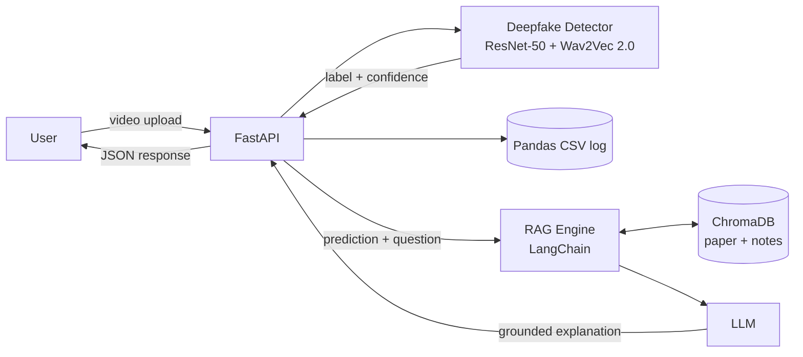

# DeepGuard

**Deepfake detection API with retrieval-augmented explanations.**

DeepGuard serves a multimodal PyTorch deepfake detector through a FastAPI service and pairs it with a
RAG assistant (LangChain + ChromaDB) that explains each prediction in plain language, grounded only in
the project's own research paper and notes.


---

## Table of Contents
- [Overview](#overview)
- [Features](#features)
- [Architecture](#architecture)
- [Model](#model)
- [Tech Stack](#tech-stack)
- [Project Structure](#project-structure)
- [Getting Started](#getting-started)
- [Configuration](#configuration)
- [API Reference](#api-reference)
- [Limitations](#limitations)
- [Roadmap](#roadmap)
- [Author](#author)

## Overview
Deepfake classifiers usually return a label and a score with no context. DeepGuard goes a step further:
after classifying an uploaded video as **real** or **fake**, it retrieves relevant passages from the
project's documentation and uses an LLM to explain what the result means, how the method works, and
where it can fail. Answers are restricted to the retrieved text to reduce hallucination.

## Features
- **Multimodal detection:** combines visual and audio cues rather than relying on video alone.
- **REST API:** upload a video and receive a label and confidence score.
- **Grounded explanations:** RAG pipeline answers questions using only the project's own documents.
- **Prediction logging and analysis:** every prediction is logged with Pandas, with NumPy summary statistics
  and low-confidence tracking.
- **Demo mode:** run the full API without model weights for development and testing.

## Architecture



## Model
The detector fuses two modalities:
- **Visual stream:** ResNet-50 features extracted from video frames.
- **Audio stream:** Wav2Vec 2.0 features extracted from the audio track.
- **Fusion:** a cross-attention layer lets the visual stream attend to the audio stream, which helps surface
  mismatches between lip movement and speech.

The model was developed as a final-year project and reached **97.33% accuracy on the FakeAVCeleb dataset**.
An IEEE-format paper and project report accompany the work.

## Tech Stack
| Area | Tools |
|---|---|
| Deep learning | Python, PyTorch, ResNet-50, Wav2Vec 2.0 |
| API | FastAPI, Uvicorn, Pydantic |
| RAG | LangChain, ChromaDB, sentence-transformers |
| LLM | Anthropic API (configurable) |
| Data and analysis | Pandas, NumPy |

## Project Structure
```
deepguard/
├── app/
│   ├── main.py        # FastAPI app and endpoints
│   ├── model.py       # detector wrapper (load weights, run inference)
│   ├── rag.py         # chunking, embeddings, ChromaDB retrieval, LLM answers
│   └── logger.py      # Pandas logging and NumPy summary statistics
├── docs/              # paper, report and notes used for retrieval
├── weights/           # trained model weights (not committed)
├── ingest.py          # builds the ChromaDB index from docs/
├── requirements.txt
└── README.md
```

## Getting Started

### Prerequisites
- Python 3.10 or newer
- Trained model weights saved as `weights/deepguard.pt`
- (Optional) an Anthropic API key for LLM-generated answers

### Installation
```bash
git clone <your-repo-url>
cd deepguard
python -m venv .venv && source .venv/bin/activate
pip install -r requirements.txt
```

### Connect the trained model
Open `app/model.py` and complete the two marked `TODO` sections: load your model class and weights, and
reuse your frame and audio preprocessing for inference. Then place the weights at `weights/deepguard.pt`.

### Build the knowledge base
Add your paper, report or notes (`.pdf`, `.txt` or `.md`) to `docs/`, then index them:
```bash
python ingest.py
```

### Run the server
```bash
export ANTHROPIC_API_KEY=your_key_here   # optional
uvicorn app.main:app --reload
```
Interactive API docs are available at `http://127.0.0.1:8000/docs`.

To try the API without model weights:
```bash
DEMO_MODE=1 uvicorn app.main:app --reload
```
Demo mode returns random predictions and is for testing the pipeline only.

## Configuration
| Variable | Default | Description |
|---|---|---|
| `ANTHROPIC_API_KEY` | none | Enables LLM answers. Without it, `/ask` returns retrieved context only. |
| `LLM_MODEL` | `claude-sonnet-5-5` | LLM used for explanations. |
| `EMBED_MODEL` | `sentence-transformers/all-MiniLM-L6-v2` | Embedding model for retrieval. |
| `WEIGHTS_PATH` | `weights/deepguard.pt` | Location of trained weights. |
| `DOCS_DIR` | `docs` | Folder of documents to index. |
| `CHROMA_DIR` | `chroma_db` | ChromaDB persistence folder. |
| `DEMO_MODE` | `0` | Set to `1` to run with a dummy detector. |

## API Reference

| Method | Endpoint | Description |
|---|---|---|
| `GET` | `/health` | Service status |
| `POST` | `/predict` | Classify an uploaded video |
| `POST` | `/predict_and_explain` | Classify and return a grounded explanation |
| `POST` | `/ask` | Ask a question about the project |
| `GET` | `/stats` | Summary of logged predictions |

### Examples
**Predict**
```bash
curl -X POST http://127.0.0.1:8000/predict -F "video=@sample.mp4"
```
```json
{ "label": "fake", "confidence": 0.91, "p_fake": 0.91 }
```

**Predict and explain**
```bash
curl -X POST http://127.0.0.1:8000/predict_and_explain -F "video=@sample.mp4"
```
```json
{
  "prediction": { "label": "fake", "confidence": 0.91, "p_fake": 0.91 },
  "explanation": { "answer": "...", "sources": ["deepfake_notes.md"] }
}
```

**Ask a question**
```bash
curl -X POST http://127.0.0.1:8000/ask \
  -H "Content-Type: application/json" \
  -d '{"question": "Why does the model use cross-attention?"}'
```

**Stats**
```bash
curl http://127.0.0.1:8000/stats
```
```json
{ "total": 12, "fake_count": 5, "real_count": 7, "mean_confidence": 0.84,
  "median_confidence": 0.87, "low_confidence_threshold": 0.6, "low_confidence_count": 1 }
```

## Limitations
- Accuracy reported on FakeAVCeleb may not carry over to other manipulation methods, compression levels or
  recording conditions.
- Predictions with confidence close to 0.5 should be reviewed by a human.
- Explanations describe the method and its known limits. They are not a forensic analysis of the specific video.
- Large videos increase inference time. Add file-size limits before exposing the API publicly.

## Roadmap
- [ ] Per-video visual and audio evidence in explanations (for example, frame-level scores)
- [ ] File-size and format validation
- [ ] Docker image
- [ ] Simple web front end for uploads
- [ ] Test suite and CI

## Author
**Upputuri Madhu Mohan**
B.Tech CSE (AI & ML), R.V.R & J.C College of Engineering
[LinkedIn](#) | [GitHub](#) | [Email](#)